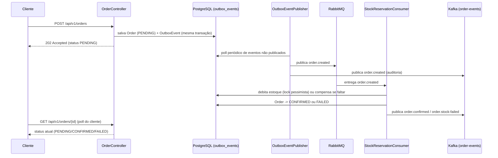

# Projeto Java — API REST de Estudo

API REST construída com **Spring Boot 3**, **JPA/Hibernate**, **PostgreSQL**, **RabbitMQ** e **Kafka**, totalmente containerizada com **Docker** e **Docker Compose**.

Projeto de estudo focado na stack da vaga: Java · Spring Boot · Hibernate · PostgreSQL · APIs REST · Mensageria assíncrona · Docker · Clean Code · SOLID · DDD · Design Patterns.

---

## Stack

| Camada | Tecnologia |
|---|---|
| Linguagem | Java 21 |
| Framework | Spring Boot 3.3.5 |
| Segurança | Spring Security + JWT (`io.jsonwebtoken`) |
| ORM | Spring Data JPA / Hibernate |
| Banco de dados | PostgreSQL 14 |
| Mensageria (fila de trabalho) | RabbitMQ |
| Mensageria (stream de eventos) | Apache Kafka |
| Migrations | Flyway |
| Documentação | SpringDoc OpenAPI 3 (Swagger UI) |
| Formatação | Spotless + Google Java Format |
| Build | Maven 3.9 |
| Container | Docker + Docker Compose |

---

## Pré-requisitos

- [Docker](https://docs.docker.com/get-docker/) ≥ 24
- [Docker Compose](https://docs.docker.com/compose/) ≥ 2.20
- `make`

> **Tudo roda dentro do Docker.** Não é necessário ter Java, Maven, PostgreSQL, RabbitMQ ou Kafka instalados na máquina. A aplicação nunca deve ser executada fora de container.

---

## Início rápido

```bash
# 1. Sobe banco + RabbitMQ + Kafka + aplicação (faz o build automaticamente)
make up

# 2. Acompanha os logs da aplicação
make logs-app
```

A API estará disponível em **http://localhost:8088**.

---

## Comandos disponíveis (`make help`)

```
  up                Sobe todos os serviços (build se necessário)
  up-db             Sobe apenas o banco de dados
  down              Para e remove os containers
  build             Reconstrói as imagens sem usar cache
  restart           Reinicia todos os serviços
  logs              Acompanha os logs de todos os serviços
  logs-app          Acompanha os logs apenas da aplicação
  logs-db           Acompanha os logs apenas do banco
  ps                Lista os containers em execução
  shell-app         Abre um shell no container da aplicação
  shell-db          Abre o psql no container do banco
  test              Executa os testes dentro do container Maven
  format            Formata o código com Spotless (Google Java Format)
  lint              Verifica a formatação sem aplicar (falha se houver diff)
  migration         Cria uma nova migration Flyway. Uso: make migration name=add_column_x
  clean             Remove artefatos de build
```

---

## Documentação da API

Com a aplicação rodando, acesse:

| URL | Descrição |
|---|---|
| http://localhost:8088/swagger-ui.html | Swagger UI interativo |
| http://localhost:8088/api-docs | Spec OpenAPI 3 em JSON |
| http://localhost:8088/actuator/health | Health check |
| http://localhost:15672 | RabbitMQ Management UI (usuário/senha: `java`/`java`) |

A maioria dos endpoints exige um JWT. No Swagger UI, clique em **Authorize** e cole **apenas o token puro**, sem o prefixo `Bearer` (o Swagger já adiciona esse prefixo automaticamente, por causa do `scheme("bearer")` configurado em `OpenApiConfig`). Obtenha o token em `/api/v1/auth/login`.

> Fora do Swagger (curl, Postman, Insomnia etc.), o prefixo `Bearer ` **deve** ser incluído manualmente no header `Authorization`.

---

## Autenticação

### `POST /api/v1/auth/register`

Cria um novo usuário e já retorna um JWT.

**Body:**
```json
{ "name": "Cristian", "email": "cristian@example.com", "password": "senha12345" }
```

### `POST /api/v1/auth/login`

**Body:**
```json
{ "email": "cristian@example.com", "password": "senha12345" }
```

**Resposta `200`:**
```json
{ "token": "eyJ...", "email": "cristian@example.com", "role": "USER", "expiresAt": "2026-10-28T03:00:00" }
```

Use o `token` no header `Authorization: Bearer <token>` nas chamadas seguintes (via curl/Postman). No Swagger UI, cole apenas o `<token>`, sem `Bearer ` — veja a seção [Documentação da API](#documentação-da-api).

---

## Produtos

| Método | Rota | Auth | Descrição |
|---|---|---|---|
| `GET` | `/api/v1/products` | Pública | Lista produtos ativos |
| `GET` | `/api/v1/products/{id}` | Pública | Busca produto por ID |
| `POST` | `/api/v1/products` | JWT | Cria produto |
| `PUT` | `/api/v1/products/{id}` | JWT | Atualiza nome/descrição/preço |
| `DELETE` | `/api/v1/products/{id}` | JWT | Desativa produto (soft delete) |

**`POST /api/v1/products`:**
```json
{ "name": "Teclado Mecânico", "description": "Switch Cherry MX Red, RGB, ABNT2", "price": 299.90, "stock": 10 }
```

---

## Pedidos (assíncronos) — o coração da mensageria

Diferente dos produtos, a criação de pedido **não reserva estoque de forma síncrona**. O fluxo é:



- **Transactional Outbox:** o evento `order.created` é gravado na **mesma transação** do pedido — nunca existe o problema de "pedido salvo mas evento perdido" ou vice-versa.
- **RabbitMQ** é usado como **fila de trabalho**: exatamente um consumidor processa cada pedido (reserva de estoque).
- **Kafka** é usado como **stream de auditoria**: todo evento (`order.created`, `order.confirmed`, `order.stock-failed`) é publicado no tópico `order-events`, particionado por `orderId`, para quem quiser consumir de forma independente (analytics, auditoria futura).
- **Saga com compensação:** se qualquer item do pedido não tiver estoque suficiente, todo estoque já debitado **daquele mesmo pedido** é devolvido (compensado) antes de marcar o pedido como `FAILED` — nunca fica um pedido com reserva parcial.
- **Idempotência:** RabbitMQ/Kafka entregam mensagens *at-least-once* (podem reentregar). Uma tabela `processed_messages` garante que uma mensagem redelivered não debita o estoque duas vezes.
- **Chain of Responsibility para erros de mensageria:** qualquer exceção levantada ao processar uma mensagem passa por uma cadeia de responsabilidade (`MessagingErrorHandler`) que decide se a mensagem deve ser reprocessada (`RETRY`), enviada direto para a dead-letter queue (`REJECT_TO_DEAD_LETTER`) ou confirmada (`ACKNOWLEDGE`) — nunca um `try/catch` solto no consumer.

| Método | Rota | Auth | Descrição |
|---|---|---|---|
| `POST` | `/api/v1/orders` | JWT | Cria pedido — responde `202 Accepted` com status `PENDING` |
| `GET` | `/api/v1/orders/{id}` | JWT | Consulta status atual do pedido |

**`POST /api/v1/orders`:**
```json
{
  "deliveryAddress": { "street": "Rua A, 100", "city": "São Paulo", "state": "SP", "zip": "01000-000" },
  "items": [ { "productId": 1, "quantity": 2 } ]
}
```

---

## Upload de arquivos

Tabela morfológica: um arquivo pode pertencer a um **produto** (várias fotos por produto) ou a um **usuário** (uma foto de avatar), ambos opcionais — nenhum upload é obrigatório.

| Método | Rota | Auth | Descrição |
|---|---|---|---|
| `POST` | `/api/v1/files?productId={id}` | JWT | Upload de arquivo (JPEG/PNG/PDF, máx. 10MB), `productId` opcional. Não vincula o arquivo a um usuário como avatar — use `/api/v1/users/me/avatar` para isso |
| `GET` | `/api/v1/files/{id}` | JWT | Download do arquivo |

### Perfil do usuário e avatar

O avatar do usuário autenticado é um ponteiro (`users.avatar_id`) para uma linha de `file_uploads`. Fazer upload de um novo avatar não apaga o anterior — ele continua em `file_uploads` como histórico, apenas o ponteiro é atualizado.

| Método | Rota | Auth | Descrição |
|---|---|---|---|
| `GET` | `/api/v1/users/me` | JWT | Retorna o perfil do usuário autenticado (`id`, `email`, `role`, `avatarId`, `avatarDownloadUrl`) |
| `POST` | `/api/v1/users/me/avatar` | JWT | Faz upload de uma imagem (JPEG/PNG, máx. 10MB) e a define como avatar do usuário autenticado |

```bash
# Enviar uma foto e já definir como avatar do usuário logado
curl -X POST http://localhost:8080/api/v1/users/me/avatar \
  -H "Authorization: Bearer <token>" \
  -F "file=@foto.jpg"

# Consultar o próprio perfil (inclui avatarDownloadUrl se houver avatar)
curl http://localhost:8080/api/v1/users/me \
  -H "Authorization: Bearer <token>"
```

---

## Estrutura do projeto

```
src/
├── main/
│   ├── java/br/com/projetojava/
│   │   ├── ProjectApplication.java
│   │   ├── config/OpenApiConfig.java
│   │   ├── auth/                    # Registro, login, JWT, Spring Security
│   │   ├── product/                 # Catálogo de produtos (CRUD)
│   │   ├── order/                   # Agregado Order + saga de reserva de estoque
│   │   │   ├── domain/              # Order, OrderItem, OrderStatus, DeliveryAddress
│   │   │   ├── event/               # Eventos de domínio publicados nos brokers
│   │   │   └── messaging/           # RabbitMQ/Kafka publishers e StockReservationConsumer
│   │   ├── outbox/                  # Transactional Outbox pattern
│   │   ├── messaging/
│   │   │   ├── idempotency/         # Guarda contra reentrega at-least-once
│   │   │   └── errorhandling/       # Chain of Responsibility para erros de mensageria
│   │   ├── upload/                  # Upload/download de arquivos
│   │   └── shared/
│   │       ├── exception/           # Hierarquia de exceções (um tipo por status HTTP)
│   │       ├── handler/chain/       # Chain of Responsibility para exceções HTTP
│   │       └── security/            # AuthenticatedUserResolver
│   └── resources/
│       ├── application.yml
│       ├── application-docker.yml
│       └── db/migration/            # V1..V5 — Flyway
└── test/
    └── java/br/com/projetojava/     # Espelha a estrutura de main/
```

### Injeção de dependência via interface

Toda classe depende de uma **interface** (`*Port`), nunca de outra classe concreta — o mesmo princípio de `$this->app->bind(Interface::class, Implementacao::class)` do Laravel, mas resolvido automaticamente pelo Spring: quando existe uma única implementação `@Service`/`@Component` de uma interface, o Spring a injeta sem nenhuma configuração extra. Exemplos: `ProductServicePort`, `OrderServicePort`, `JwtServicePort`, `OutboxEventServicePort`, `OrderMessagePublisherPort`, `OrderEventPublisherPort`, `StockReservationServicePort`, `IdempotencyGuardPort`.

### Design patterns utilizados

- **Chain of Responsibility** — tratamento de exceções HTTP (`shared/handler/chain`) e de erros de mensageria RabbitMQ/Kafka (`messaging/errorhandling/chain`)
- **Template Method** — `AbstractExceptionHandler`/`AbstractMessageErrorHandler` implementam o encadeamento; subclasses só decidem `supports`/`process`
- **Transactional Outbox** — `outbox/` garante atomicidade entre persistência e publicação de eventos
- **Saga (com compensação)** — `StockReservationService` reserva estoque item a item e compensa em caso de falha parcial
- **Dependency Inversion / Ports & Adapters** — toda dependência entre camadas é via interface

---

## Portas utilizadas

| Serviço | Porta host |
|---|---|
| API (app) | `8088` |
| PostgreSQL | `5433` |
| RabbitMQ (AMQP) | `5672` |
| RabbitMQ Management UI | `15672` |
| Kafka | `9092` |

> Portas `5432` e `8080` são evitadas de propósito (reservadas por outros containers na rede do host).

---

## Variáveis de ambiente

Configuradas no `docker-compose.yml`. Para sobrescrever localmente, crie um arquivo `.env` na raiz:

```env
SPRING_DATASOURCE_URL=jdbc:postgresql://postgres:5432/java
SPRING_DATASOURCE_USERNAME=java
SPRING_DATASOURCE_PASSWORD=java
SPRING_PROFILES_ACTIVE=docker
SPRING_RABBITMQ_HOST=rabbitmq
SPRING_KAFKA_BOOTSTRAP_SERVERS=kafka:9092
```

---

## Formatação de código

O projeto usa **Spotless** com **Google Java Format**. Antes de commitar:

```bash
make format   # aplica a formatação
make lint     # verifica sem aplicar (útil no CI)
```

---

## Testes

```bash
make test
```

Os testes unitários rodam dentro do container Maven (sem precisar do banco, RabbitMQ ou Kafka reais — tudo mockado com Mockito). Cobrem, entre outros:

- `ProductServiceTest` / `ProductControllerTest`
- `AuthServiceTest`
- `OrderTest` / `OrderServiceTest`
- `StockReservationServiceTest` (saga de reserva de estoque com compensação)
- `StockReservationConsumerTest` (decisão RETRY/REJECT_TO_DEAD_LETTER/ACKNOWLEDGE)
- `IdempotencyGuardTest`
- `GlobalExceptionHandlerTest` (chain HTTP — todos os status 4xx/5xx)
- `MessagingErrorHandlerTest` e os testes de cada elo da chain de mensageria
